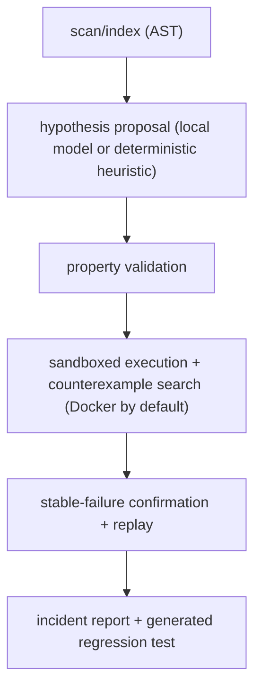

# FaultMesh

[](https://github.com/smangat1/FaultMesh/actions/workflows/ci.yml)

FaultMesh is an offline-first, evidence-driven bug discovery and reproduction framework for
Python. A bounded model or deterministic proposer suggests an explicit behavioral property;
FaultMesh validates that property, searches for a counterexample with Hypothesis, reproduces the
failure, persists its evidence in SQLite, and emits an executable regression test plus JSON and
Markdown incident reports.

V1 also runs an existing pytest suite in a configured, locked-down Docker container and stores an
honest machine-readable result. This path does not call an AI model.

V2 optionally records per-test line and symbol observations with coverage.py dynamic contexts.
It can inspect and export those records without the checkout, then replay one recorded failed
pytest node in the same immutable prepared image. Coverage proves observation, not causality.

V3 builds a deterministic, non-executing schema 3.0 map of every Python file and symbol, honest
static imports and possible calls, Git file/symbol changes, and an optional V2 coverage overlay.

The model is not the oracle. A finding reaches `VERIFIED` only after a validated property is
violated by a stable, repeated execution.

## Verification pipeline



## Example demonstration run

> [!NOTE]
> **Demonstration fixture label**: The output and artifacts below are from a demonstration run against the bundled, seeded fixture (`examples/buggy_python_project`) using the deterministic, docstring-grounded heuristic backend (`--model heuristic`) and local execution (`--allow-local-execution`). This demonstrates FaultMesh's pipeline machinery, counterexample search, and output formats; it is **not** evidence of what a real small language model finds. For real-model validation using Qwen2.5-Coder-1.5B under locked-down Docker sandboxing, see [docs/milestone-1-validation.md](docs/milestone-1-validation.md).

Running the analysis command:

```console
faultmesh analyze examples/buggy_python_project --model heuristic --allow-local-execution
```

Emits the investigation summary:

```json
{
  "investigation_id": "inv-681652599c89",
  "indexed_functions": 3,
  "hypotheses": [
    "hyp-e51c54fec6da"
  ],
  "incidents": [
    "inc-f736512d10e4"
  ],
  "evidence_database": "/Users/samyanmangat/Downloads/FaultMesh/examples/buggy_python_project/.faultmesh/evidence.sqlite3",
  "sandbox": "local-subprocess-UNSAFE",
  "model_calls": 3
}
```

### Verified incident report excerpt (`report.md`)

````markdown
# bounded_increment violates its documented boundary

**Verification status:** `VERIFIED`  
**Incident:** `inc-f736512d10e4`  
**Hypothesis:** `hyp-e51c54fec6da`  
**Model confidence (not verification):** 0.78

## Summary

FaultMesh observed a stable violation of an explicit property for
`bounded_increment`. The failure reproduced in
3/3 confirmation runs
(100.0%).

## Affected source

- `src/buggy_python_project/bounds.py:1-8`

## Expected behavior and evidence

The result is less than or equal to maximum.

Oracle: The function docstring states that the result must never exceed maximum.

## Observed behavior

returned 1; expected result <= maximum (0)

Counterexample:

```json
{
  "maximum": 0,
  "value": 0
}
```

Failure fingerprint: `eead832e25ee2c693e55aa6e`
````

### Generated regression test (`test_inc_f736512d10e4.py`)

Verbatim regression test emitted under `.faultmesh/incidents/inc-f736512d10e4/`:

```python
"""Regression test generated by FaultMesh for inc-f736512d10e4."""
import importlib.util
import json
import os
from pathlib import Path

repository = Path(os.environ.get("FAULTMESH_REPOSITORY", '/Users/samyanmangat/Downloads/FaultMesh/examples/buggy_python_project')).resolve()
source = (repository / 'src/buggy_python_project/bounds.py').resolve()
assert source.is_relative_to(repository), "source path escaped repository"
module_spec = importlib.util.spec_from_file_location("_faultmesh_regression_target", source)
assert module_spec is not None and module_spec.loader is not None
module = importlib.util.module_from_spec(module_spec)
module_spec.loader.exec_module(module)
function = module
for name in 'bounded_increment'.split("."):
    function = getattr(function, name)
arguments = json.loads('{"maximum": 0, "value": 0}')


def test_inc_f736512d10e4() -> None:
    result = function(**arguments)
    assert result <= arguments['maximum']
```

## Milestone 1 status

Current status: Milestone 1 vertical slice is complete and validated on offline local hardware per docs/milestone-1-validation.md; further milestones are planned and in progress.

Implemented:

- Python AST indexing with hashes, functions, classes, calls, branches, handlers, and assertions.
- A versioned Pydantic contract for hypotheses and executable property specifications.
- llama.cpp server and CLI adapters with JSON validation, repair retries, and usage metadata.
- Safe compilation of a small precondition subset into executable property constraints.
- A documented deterministic heuristic backend for offline integration testing.
- An SQLite evidence graph with typed records, edges, revisions, and guarded state transitions.
- Allowlisted property/oracle validation, Hypothesis counterexample search and shrinking.
- A Docker sandbox (secure default) and an explicit unsafe local subprocess fallback.
- Stable-failure confirmation, fingerprints, replay, pytest artifact generation, and Markdown/JSON
  reports.
- A deliberately buggy example and end-to-end tests.

Validated on an 8 GB Apple M2 with llama.cpp 0.7.0, the official Qwen2.5-Coder-1.5B-Instruct
Q4_K_M GGUF, and an ARM64 Docker engine: both the `llama-server` path and the batch
`llama-completion` CLI path proposed the boundary hypothesis, the locked-down container found and
shrank the counterexample, and saved-artifact replay matched the failure fingerprint. See
[docs/milestone-1-validation.md](docs/milestone-1-validation.md) for exact versions, measurements,
isolation probes, and remaining limitations. Multi-agent roles and flaky-test investigation belong
to later milestones.

## V1 project runner status

V1 passed its real-project gate on 2026-10-26. FaultMesh ran all 502 tests from a pinned hpack
revision twice in offline containers, recorded two independent passing runs, preserved the target
checkout, and correctly reported controlled failure and timeout cases. The runtime used a
read-only source mount and root filesystem, a non-root user, no network, no effective capabilities,
`no-new-privileges`, and CPU, memory, PID, and time limits.

The supported boundary is deliberately small: Git checkouts, digest-pinned Python images, simple
`name==version` test dependencies, and argv-form pytest commands. It does not install the target
package or run project setup hooks. See [docs/v1-project-runner.md](docs/v1-project-runner.md) for
the V1 boundary and [docs/v2-test-evidence.md](docs/v2-test-evidence.md) for V2 observation,
replay, acceptance evidence, and limitations.

## Install and run

```console
python3.11 -m venv .venv
. .venv/bin/activate
python -m pip install -e '.[dev]'
faultmesh analyze examples/buggy_python_project --model heuristic --allow-local-execution
```

The local runner executes repository code on the host and is intended only for trusted fixtures.
For an untrusted repository, omit `--allow-local-execution`; FaultMesh uses Docker with networking
disabled, a read-only root filesystem, resource limits, and a non-root user.
Add `--json-logs` to emit redacted, machine-readable progress events on stderr while keeping the
execution summary on stdout.

For llama.cpp's OpenAI-compatible server:

```console
faultmesh analyze ./repository --model llama-server \
  --llama-endpoint http://127.0.0.1:8080/v1/chat/completions
```

Or configure `.faultmesh.toml` (see [docs/configuration.md](docs/configuration.md)). Other commands:

```console
faultmesh reproduce <incident-id> --repository ./repository
faultmesh report <incident-id> --repository ./repository --format markdown
faultmesh inspect ./repository
faultmesh run-tests --observe /path/to/project-run.toml
faultmesh test-run <run-id> --config /path/to/project-run.toml
faultmesh test-cases <run-id> --config /path/to/project-run.toml
faultmesh test-evidence <run-id> '<exact-node-id>' --config /path/to/project-run.toml
faultmesh replay-test <run-id> '<exact-failed-node-id>' --config /path/to/project-run.toml
faultmesh export-run <run-id> --config /path/to/project-run.toml
faultmesh structure /path/to/project --out structure.json
faultmesh structure-summary structure.json
```

See [docs/architecture.md](docs/architecture.md) for architecture, contracts, risks, the complete
data flow, and Milestone 1 acceptance criteria. The supported programmatic surface is documented in
[docs/api.md](docs/api.md). To reproduce the automated, Docker-isolation, and real-model checks, use
the copy-paste procedure in [docs/testing.md](docs/testing.md).

The schema 3.0 structure contract, static-evidence limits, Git comparison behavior, V2 join, and
real-project V3 acceptance are documented in
[docs/v3-static-structure.md](docs/v3-static-structure.md).

## Try it manually

1. **Terminal 1:** Run `python scripts/spectate_demo_editor.py`. It prints a copy folder path and waits for Enter. Leave it waiting and do not press Enter yet.
2. Watch that printed copy folder, either way:
   - **Desktop app:** Run `./run-desktop.sh`, choose the printed copy folder, and start watching.
   - **Command line:** Open a second terminal (Terminal 1 must stay open and waiting) and run `faultmesh spectate <the printed copy path>`.
3. Go back to Terminal 1 and press Enter. The edits happen on the copy and events appear in the watcher.

To edit by hand instead, open the same printed copy folder in VS Code (not the repository's `examples/vscode_playground`) while the watcher runs on it.

> [!NOTE]
> Today on `main`, live spectate streams stable fact records (`spectate-1.0`) such as file changes, diffs, and parse-error retention. Live map binding and code/diff view wiring are not completed until PR #8 lands.

## Safety

Scanning is non-executing. Verification is a separate phase. Docker is the product default and
network access is disabled. The worker rejects source that no longer matches the scan-time content
hash and replay input outside the accepted property domain. Host execution requires the explicit
`--allow-local-execution` flag and is not a security boundary. FaultMesh never publishes findings.

## Development

```console
python -m pytest
ruff check .
mypy
```

Contributions are welcome; read [CONTRIBUTING.md](CONTRIBUTING.md). FaultMesh is licensed under the
Apache License 2.0.
